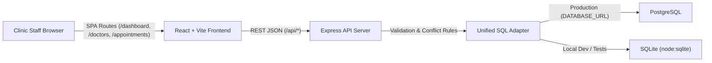
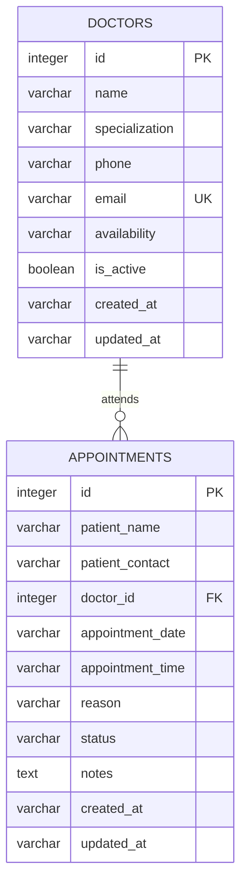

# BrightSmile Dental Clinic Management System — Project Documentation

> **GitHub Repository (`develop` branch):** [`https://github.com/Nabeelhussa/BrightSmile/tree/develop`](https://github.com/Nabeelhussa/BrightSmile/tree/develop)  
> **GitHub Repository URL:** [`https://github.com/Nabeelhussa/BrightSmile.git`](https://github.com/Nabeelhussa/BrightSmile.git)  
> **Loom Video Walkthrough:** *(Insert your Loom video URL here when recorded)*  
> **Live Render Deployment URLs:** *(Insert your Render Web Service & Static Site URLs here when deployed)*

---

## 1. Architecture Summary

BrightSmile Dental Clinic Management System is a full-stack CRUD web application composed of three cleanly separated layers:

1. **Frontend (`client/`)**: Built with **React 18**, **Vite 6**, and **`react-router-dom` v6**, styled with modular CSS design tokens (`tokens.css`, `global.css`, `components.css`). Uses reusable UI primitives (`AppLayout`, `SidebarNav`, `StatCard`, `DataTable`, `Modal`, `ConfirmDialog`, `FormControls`, `Badge`, `EmptyState`, `ErrorState`, `LoadingState`, and `ToastProvider`) so pages remain clean and consistent across desktop and mobile viewports.
2. **Backend API (`server/`)**: Built with **Node.js** and **Express 4**, exposing RESTful JSON endpoints under `/api/health`, `/api/doctors`, and `/api/appointments`. Implements structured input validation, duplicate email protection, foreign-key doctor checks, inactive-doctor booking prevention, 30-minute overlap detection, and centralized error handling.
3. **Relational Database (`server/src/db/`)**: Supports **PostgreSQL** (`pg`) in production/Render when `DATABASE_URL` is configured, and Node's built-in **`node:sqlite`** relational engine for zero-configuration local development and automated in-memory testing. Both dialects share the same relational schema, foreign key constraints, indexes, and idempotent startup seeding.



---

## 2. Database Model

### Entity-Relationship Diagram



### Schema Rules & Integrity
- **Primary Keys**: `SERIAL` in PostgreSQL, `INTEGER PRIMARY KEY AUTOINCREMENT` in SQLite.
- **Unique Constraint**: `doctors.email` is unique (case-insensitive check enforced in the controller + unique index in DB).
- **Foreign Key**: `appointments.doctor_id` references `doctors(id) ON DELETE CASCADE` (with `PRAGMA foreign_keys = ON` enabled in SQLite).
- **Check Constraint**: `appointments.status` is constrained to `'pending' | 'confirmed' | 'completed' | 'cancelled'`.
- **Indexes**:
  - `idx_appointments_doctor_date` on `(doctor_id, appointment_date, appointment_time)` for fast overlap and schedule queries.
  - `idx_appointments_status` on `(status)`.

---

## 3. API Routes

All responses use JSON:
- **Success**: `{ "success": true, "data": ..., "message"?: "..." }`
- **Error**: `{ "success": false, "error": { "code": "...", "message": "...", "details"?: { ... } } }`

| Method | Path | Purpose | Status Codes |
| --- | --- | --- | --- |
| `GET` | `/api/health` | Verifies API and database connectivity | `200`, `503` |
| `GET` | `/api/doctors` | Lists doctors; supports `search`, `specialization`, `active` | `200` |
| `GET` | `/api/doctors/:id` | Returns doctor profile and assigned appointments | `200`, `400`, `404` |
| `POST` | `/api/doctors` | Creates a new doctor | `201`, `400`, `409` |
| `PUT` / `PATCH` | `/api/doctors/:id` | Updates doctor details or active status | `200`, `400`, `404`, `409` |
| `DELETE` | `/api/doctors/:id` | Deletes a doctor and cascades linked appointments | `200`, `400`, `404` |
| `GET` | `/api/appointments` | Lists appointments; supports `search`, `status`, `doctor_id`, `date` | `200`, `400` |
| `GET` | `/api/appointments/:id` | Returns appointment details with doctor metadata | `200`, `400`, `404` |
| `POST` | `/api/appointments` | Schedules appointment (checks active doctor & 30-min overlap) | `201`, `400`, `409` |
| `PUT` / `PATCH` | `/api/appointments/:id` | Updates appointment fields or quick status | `200`, `400`, `404`, `409` |
| `DELETE` | `/api/appointments/:id` | Deletes an appointment | `200`, `400`, `404` |

---

## 4. Setup & Deployment Steps

### Local Development
1. Clone repository and switch to `develop`:
   ```bash
   git clone https://github.com/Nabeelhussa/BrightSmile.git
   cd BrightSmile
   git checkout develop
   ```
2. Install dependencies: `npm run install:all`
3. Copy `server/.env.example` to `server/.env` and `client/.env.example` to `client/.env`
4. Run both backend and frontend: `npm run dev`
5. Open `http://localhost:5173` (API runs on `http://localhost:5000`).

### Render Deployment (`render.yaml`)
1. Connect the GitHub repository (`https://github.com/Nabeelhussa/BrightSmile.git`, `develop` branch) in Render via **New + -> Blueprint**.
2. Render provisions `dental-clinic-db` (PostgreSQL), `dental-clinic-api` (Node Web Service), and `dental-clinic-web` (Static Site).
3. Set `VITE_API_URL` on `dental-clinic-web` to `https://<your-api-service>.onrender.com/api` and deploy.
4. Verify `/api/health` returns `status: "ok"`.

---

## 5. Screenshots & Visual Verification

- **Dashboard Page (`/dashboard`)**: Summary KPI stat cards + upcoming appointments table + doctors roster snapshot.
- **Doctors Directory (`/doctors`)**: Search/filters + Doctor Detail modal + Add/Edit doctor forms.
- **Appointments Schedule (`/appointments`)**: Filters + inline status update pills + 30-minute slot overlap validation.
- **Delete Confirmation & Empty/Error Recovery States**.

---

## 6. Testing Notes

- **Backend Integration Tests (`npm test`)**: Executed with `node --test server/tests/api.test.js` against an isolated in-memory relational database covering:
  - `GET /api/health` database connectivity check.
  - Full Doctor CRUD lifecycle (`GET`, `POST`, `PATCH`, `DELETE`), field validation (`400`), duplicate email rejection (`409`), and post-delete `404`.
  - Full Appointment CRUD lifecycle, non-existent doctor rejection (`400`), inactive doctor booking rejection (`409`), 30-minute overlap conflict rejection (`409`), status updates, and deletion.
- **Frontend Production Build (`npm run build`)**: Verified Vite production bundling (`client/dist`).

---

## 7. Known Limitations

1. **Authentication & Role-Based Access**: No user login/authentication layer is included in this MVP; all clinic staff actions are open on the practice interface.
2. **Fixed Appointment Duration**: Overlap prevention assumes a uniform 30-minute appointment slot per doctor rather than variable per-procedure durations.
3. **Free-Tier Cold Starts**: When hosted on Render's free tier, the backend service sleeps after inactivity and may take 30–50 seconds to wake on the first request.
4. **Doctor Availability Parsing**: `availability` is stored as descriptive schedule text (e.g., `"Mon - Fri, 09:00 AM - 05:00 PM"`) rather than enforced working-hour time ranges per weekday.
